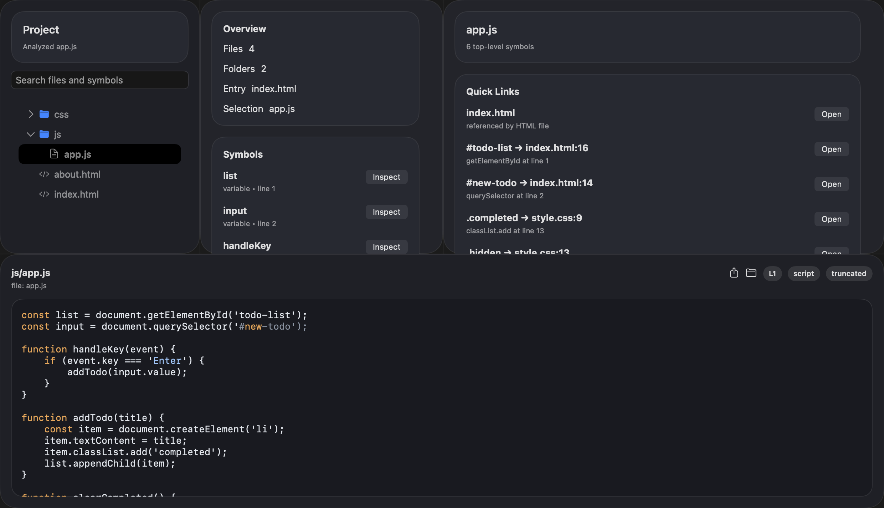

# LumenCode

LumenCode is a structural code explorer for Linux, macOS and Windows. Browse
local source trees, inspect symbols and source, and follow relationships across
files. All three native apps share the same analysis engine and language support.

## Downloads

Version **0.1.0** is available from [lumencode.app](https://lumencode.app/) and
[GitHub Releases](https://github.com/macsplit/lumencode/releases/tag/v0.1.0).

| Platform | Download | Install |
| --- | --- | --- |
| Linux x86_64 | Signed Flatpak | Use the website's Flatpak install link for repository updates, or download the standalone bundle. |
| macOS Intel / Apple Silicon | Universal ZIP, macOS 14+ | Extract and drag LumenCode to Applications. Developer ID signed and notarized by Apple. |
| Windows x64 | Portable ZIP, Windows 10 2004+ | Extract the entire ZIP and run `LumenCode.Windows.exe`. Unsigned; Windows may warn or block it under some security policies. |

See the [release notes](docs/releases/0.1.0.md) for checksums, package provenance,
validation and remaining platform testing.

## Explore your code

- Browse folders, files, types and members in a local source tree.
- Inspect syntax-coloured source and follow calls, dependencies and links across files.
- Search files and symbols, including projects with incomplete source.

Language support includes PHP, JavaScript, TypeScript, TSX, QML, CSS, HTML, JSON,
Python, C/C++, Java, C#, Rust, Swift and Objective-C. Available detail varies by
language. See more [screenshots](https://lumencode.app/) and the
[user guide](docs/qt/end-user-guide.md).

## Development

Clone this repository once to work on any platform; no submodules are needed.
See [building and verification](docs/building.md), the [shared engine guide](engine/README.md)
and the [documentation index](docs/README.md). Further clean-machine testing and
GUI refinements are ongoing; current validation limits are in the
[release notes](docs/releases/0.1.0.md#validation-and-limits).

[Report an issue](https://github.com/macsplit/lumencode/issues) · [GPLv3 license](LICENSE)
