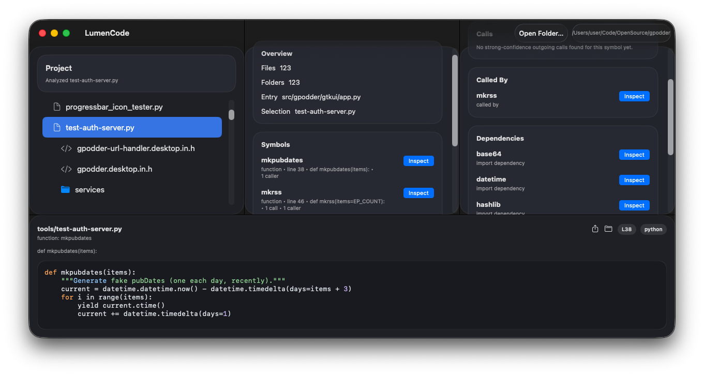

# LumenCode (Swift)

A macOS tool for source code exploration.

*This version is a Swift and SwiftUI port of `lumencode`, with a native C++ bridge for analysis logic and a separate internal CLI harness for tight development loops.*

## Screenshot



## What is in this repo

- `lumencode-swift.xcodeproj`
  A real macOS app project for day-to-day GUI development in Xcode.
- `Package.swift`
  Swift Package manifest used for the shared core, native bridge, and CLI harness.
- `Sources/LumencodeSwiftApp`
  SwiftUI macOS interface layer.
- `Sources/LumencodeCore`
  Shared Swift models and workspace helpers used by both the GUI and CLI.
- `Sources/LumencodeNativeBridge`
  Native C/C++ bridge boundary used by Swift for file analysis.
- `Sources/LumencodeCLI`
  Internal harness for regression-style development and analysis validation.

## Open and run

For the GUI app, open:

- `lumencode-swift/lumencode-swift.xcodeproj`

Then in Xcode:

1. Select the `lumencode-swift` scheme.
2. Click Run.
3. Use `Open Folder…` in the app to inspect a project.

Important:

- Do not open `Package.swift` if your goal is to run the GUI app from Xcode.
- Opening `Package.swift` gives you package executables, not the real `.app` target.

## CLI harness

The CLI is intentionally not the end-user product. It exists so backend and analysis work can be developed in a closed loop without needing manual GUI verification.

Build:

```zsh
cd /lumencode-swift
swift build
```

Run the internal harness:

```zsh
swift run lumencode-swift-cli /path/to/project
```

Dump one file analysis:

```zsh
swift run lumencode-swift-cli --dump-file /path/to/file.swift
```

## Current architecture

- GUI responsibilities:
  - project opening
  - tree navigation
  - symbol and dependency inspection
  - lower source/snippet pane
  - platform-specific presentation and interaction behavior
- Core responsibilities:
  - stable data models
  - path and snippet helpers
  - selection payload shaping
  - project scanning
- Native bridge responsibilities:
  - file parsing
  - symbol extraction
  - dependency extraction
  - native-language expansion path toward parity with the Kirigami version

## Key documents

- [Architecture Guide](docs/architecture-guide.md)
- [Development Plan](docs/development-plan.md)
- [Parity Guide](docs/parity-guide.md)
- [Tool Comparison Report](docs/tool-comparison-report.md)
- [Licensing and Derivation](docs/licensing-and-derivation.md)
- [Vendor Update Notes](docs/vendor-update-notes.md)

## Vendored parser policy

Tree-sitter code in this repo is vendored source code, not a runtime dependency on the Tree-sitter app or CLI.

That means:

- Xcode builds should work from checked-in code alone
- SwiftPM builds should work from checked-in code alone
- generated parser sources and upstream license/provenance notes must stay documented

## Current status

The Swift app now has:

- a real Xcode app target
- a working Docked macOS app
- file browsing
- symbol inspection
- dependency and route inspection hooks
- a lower source pane
- a native analysis bridge

It is still behind the Kirigami original in parser depth, detail richness, and some interface behavior.

