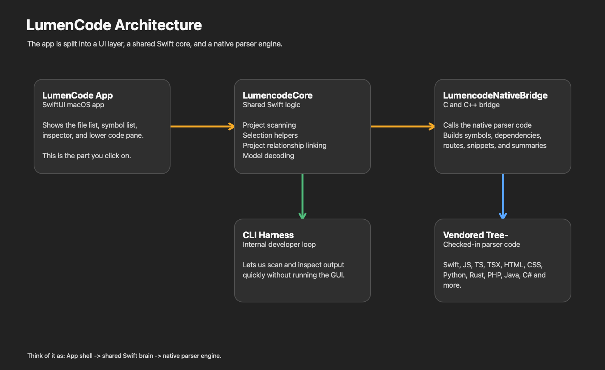
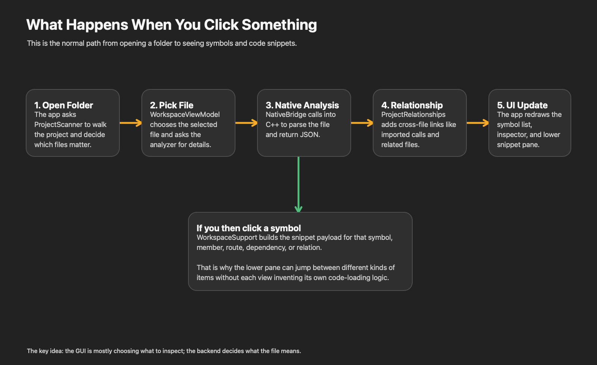
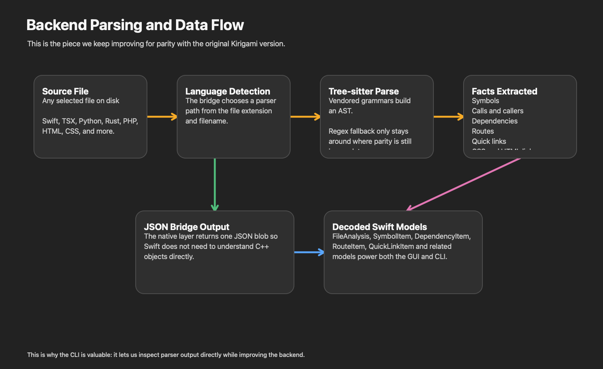

# LumenCode Architecture Guide

This document is meant to explain the shape of the app in normal language.

The short version is:

- `LumenCode` is the macOS app you run in Xcode.
- `LumencodeCore` is the shared Swift logic used by both the app and the CLI.
- `LumencodeNativeBridge` is the native parser engine written in C and C++.
- `lumencode-swift-cli` is the internal development harness we use to improve the backend quickly.

## The big picture

If you only remember one idea, make it this:

- the app is mostly the shell
- the shared Swift layer is the coordinator
- the native bridge is where the file analysis happens

That separation matters because it lets us improve the parser without rebuilding the whole interface concept every time.

## The four main parts

### 1. The macOS app

File:

- [LumencodeApp.swift](../Sources/LumencodeSwiftApp/LumencodeApp.swift)

This is the part that shows:

- the project/file list
- the symbol list
- the inspector on the right
- the lower code pane

Its job is mostly:

- respond to user clicks
- ask the core layer for data
- display the result

It is not supposed to contain the deep parsing logic.

### 2. The shared Swift core

Files:

- [Models.swift](../Sources/LumencodeCore/Models.swift)
- [NativeBridge.swift](../Sources/LumencodeCore/NativeBridge.swift)
- [ProjectScanner.swift](../Sources/LumencodeCore/ProjectScanner.swift)
- [ProjectRelationships.swift](../Sources/LumencodeCore/ProjectRelationships.swift)
- [WorkspaceSupport.swift](../Sources/LumencodeCore/WorkspaceSupport.swift)

This is the layer that keeps the app and CLI in sync.

Its job is to:

- define the shared data models
- call into the native bridge
- scan projects
- add cross-file relationships
- shape snippet payloads for the UI and CLI

This is the “brain in Swift”.

### 3. The native bridge

Files:

- [lumencode_bridge.cpp](../Sources/LumencodeNativeBridge/lumencode_bridge.cpp)
- [lumencode_bridge.h](../Sources/LumencodeNativeBridge/include/lumencode_bridge.h)

This is where the actual file understanding happens.

Its job is to:

- detect the file language
- parse the file with vendored Tree-sitter grammars
- extract symbols
- extract calls and callers where possible
- extract dependencies, routes, quick links, and snippets
- return the result as JSON

The reason it returns JSON is simple:

- Swift can decode JSON very easily
- bridging a big pile of C++ objects directly into Swift is awkward and brittle

So JSON is the clean hand-off point between native parsing and Swift UI logic.

### 4. The CLI harness

File:

- [main.swift](../Sources/LumencodeCLI/main.swift)

This is not mainly for end users.

It exists so we can:

- test the parser quickly
- inspect output without opening the GUI
- improve backend parity in a closed loop

That means the CLI is a development tool, not a competing product surface.

## What happens when you use the app

In plain English:

1. You open a folder.
2. The project scanner decides what files belong in the workspace.
3. You click a file.
4. The app asks the native analyzer to inspect that file.
5. The shared Swift layer adds project-level links like imported callers and related files.
6. The UI updates the file pane, symbol pane, inspector, and lower code pane.

Then, if you click a symbol:

- the app does not re-invent that logic per view
- it asks `WorkspaceSupport` for a snippet payload
- the lower pane updates from that shared payload

That is why symbols, routes, dependencies, and related links can all drive the same lower code pane.

## How the backend understands a file

This is the backend pipeline:

1. Read the file from disk.
2. Detect its language from the path and extension.
3. Use the matching Tree-sitter parser when available.
4. Walk the AST to extract useful facts.
5. Convert those facts into JSON.
6. Decode the JSON into shared Swift models.

Those extracted facts can include:

- symbols
- methods and members
- calls and callers
- imports and dependencies
- routes
- quick links
- CSS and HTML linkages

## Why there is both a GUI and a CLI

This can feel redundant at first, but they serve different jobs.

The GUI is for:

- exploring a project comfortably
- clicking through files and symbols
- visually checking whether relationships feel useful

The CLI is for:

- backend iteration speed
- dumping raw analysis output
- comparing parser behavior across languages
- debugging parity work without waiting on the whole UI

So the architecture is deliberately split to support both.

## Why we use vendored parser code

The repo policy is:

- checked-in code only
- no external Tree-sitter app required for normal builds

That means:

- Xcode can build from the repo alone
- SwiftPM can build from the repo alone
- parser upgrades need to be documented and vendored carefully

This is also why the native bridge target contains vendored Tree-sitter runtime and grammar code.

## How to think about responsibilities

When deciding where a change belongs, this simple rule usually helps:

- if it is about drawing or interaction, it belongs in the app layer
- if it is about shared data flow or selection behavior, it belongs in the core layer
- if it is about understanding source code, it belongs in the native bridge
- if it is about fast testing of parser output, it belongs in the CLI

## Example: clicking a function in the app

Here is the same thing in very human terms:

- you click a function name in the middle pane
- the app marks that symbol as selected
- `WorkspaceSupport` turns that symbol into a snippet payload
- the inspector shows the function details
- the lower pane shows the code
- if the symbol has `Calls` or `Called By`, those relations are shown as clickable items too

So the app behaves more like a thin navigator sitting on top of shared analysis data.

## Why parser parity work matters so much

The front end only feels smart if the backend gives it good material.

If the parser improves:

- the symbol list gets better
- the inspector gets better
- calls and callers get better
- cross-file links get better
- the lower snippet pane becomes more useful

So in practice, backend parity improvements usually create visible UI improvements even without dramatic interface redesign.

## Related documents

- [Development Plan](../docs/development-plan.md)
- [Parity Guide](../docs/parity-guide.md)
- [Licensing and Derivation](../docs/licensing-and-derivation.md)
- [Vendor Update Notes](../docs/vendor-update-notes.md)
