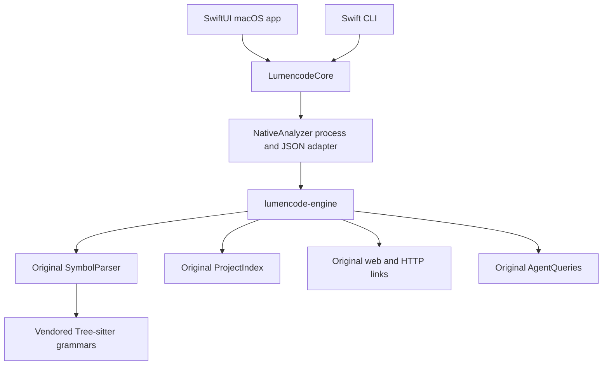

# LumenCode architecture

The SwiftUI interface and Swift CLI use the same original LumenCode analysis engine. The engine runs in a separate process with Qt Core, Qt Concurrent and the vendored Tree-sitter grammars. Swift handles macOS presentation, scanning and request scheduling.

## Analysis engine

[Engine/Upstream/src](../Engine/Upstream/src/) contains the pinned, unmodified parser, index, web-link, HTTP-link and search modules. [The provenance manifest](../Engine/upstream.json) records their revision and input hashes. [Engine/main.cpp](../Engine/main.cpp) dispatches helper requests without reimplementing language behavior.

The helper can analyse a file locally, build the project index, return indexed relationships, or run ranked search. The original engine owns AST extraction, repair, fallbacks, signatures, provenance, import binding, reciprocal calls, routes and web linkage.

The old handwritten C++ bridge is not compiled. The earlier Swift `ProjectAnalyzer`, `ProjectIndexBuilder` and `ProjectRelationships` remain as legacy scaffolding; they are not part of either product entry point. Further backend changes should go through the shared engine rather than those algorithms.

## Swift core

[NativeBridge.swift](../Sources/LumencodeCore/NativeBridge.swift) now contains the helper transport and JSON adapter. A request has a process deadline and output limit; cancellation terminates its process and escalates to a kill if necessary. Missing helpers, incompatible runtime libraries, crashes and malformed output fail explicitly.

The adapter preserves the original JSON for CLI output and maps it to [Swift models](../Sources/LumencodeCore/Models.swift) for presentation. That lets the interface use stable IDs and structured signature information without narrowing the backend contract. Original fields remain authoritative; an engine-backed analysis should not be modified in Swift to invent new facts.

[ProjectScanner.swift](../Sources/LumencodeCore/ProjectScanner.swift) supplies the macOS file tree and entrypoint. It includes the original engine's language families, module extensions and WebForms files. File browsing and the engine's indexing candidate rules remain separate responsibilities.

[WorkspaceSupport.swift](../Sources/LumencodeCore/WorkspaceSupport.swift) shapes inspection snippets. File previews use bounded reads; selecting a symbol uses the engine's snippet. A quick link carries separate source context and navigation target.

## GUI scheduling

[WorkspaceViewModel](../Sources/LumencodeSwiftApp/LumencodeApp.swift) starts local file analysis without waiting for the project index. The original index builds separately. Once it is ready, subsequent selections use indexed results; the current file is refreshed if the user is still in file context. An active symbol inspection is preserved until the next selection or refresh.

Project generations and request identity prevent obsolete results from replacing current state. The selected-result cache checks file size, modification time and inode, and distinguishes local from indexed results. Opening a project clears previous inspector/snippet data. Command-R refreshes the selected file explicitly.

The UI presents structured signatures, recovered-analysis notices, search and scope filters. Search uses the original query engine with a short debounce and cancellable requests. Command-F focuses search; Enter opens the first result. Relation navigation reopens the target file and symbol.

Lazy symbol/member layouts limit presentation work for large results. The code view avoids re-highlighting unchanged text and preserves scroll position across unrelated updates. File changes reset the overview scroll context.

## Build and packaging

SwiftPM builds the Swift targets. [tools/build_engine.py](../tools/build_engine.py) builds the pinned engine with CMake and packages relocatable private runtime libraries. Xcode runs this tool automatically and embeds its output in `LumenCode.app/Contents/Resources/EngineRuntime`.

The built app does not need the sibling repository or Homebrew library paths. Build prerequisites and the current runtime's macOS-version limitation are documented in [Engine/README.md](../Engine/README.md). Release signing and macOS 14-compatible dependencies remain separate gates.

## Verification

The [integration report](engine-integration.md) records the current fixture, live-engine comparison, packaged-runtime and GUI results. The [12 October assessment](current-assessment.md) preserves the earlier baseline. Fixture contracts and language behavior are checked through the CLI before UI presentation is reviewed.
